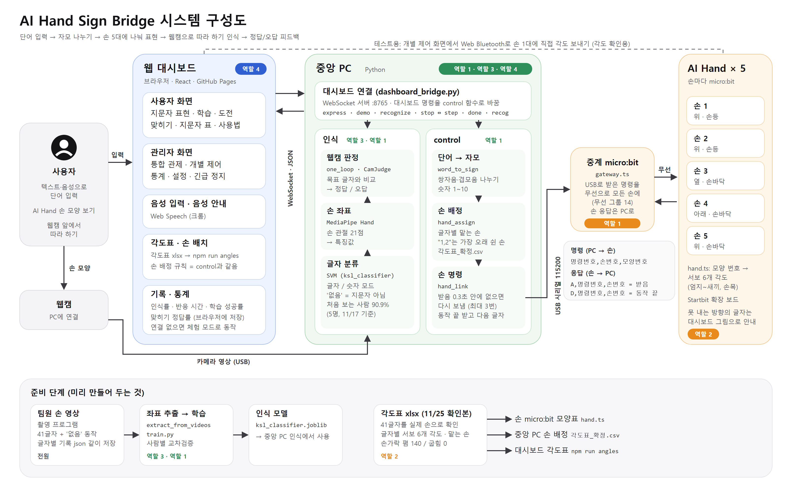

# AI Hand Sign Bridge 시스템 구성

원본 그림은 `architecture.svg`입니다. 글자를 고치려면 이 파일을 메모장으로 열어 고치고, 크롬으로 열어 캡처하면 됩니다. 발표 슬라이드에는 `architecture.png`를 넣습니다.

## 구성 요소

| 부분 | 하는 일 | 파일 | 역할 |
|---|---|---|---|
| 웹 대시보드 | 단어 입력(글자·음성), 표현·학습·도전·맞히기 화면, 관리자 화면(통합 관제·개별 제어·통계·설정) | `dashboard/` | 4 |
| 대시보드 연결 | 브라우저와 중앙 PC를 WebSocket(`ws://localhost:8765`)으로 이음 | `control/dashboard_bridge.py` | 4 |
| 단어 → 자모 | 단어를 지문자 순서로 나눔 (쌍자음 = 기본 자음 + 움직임, ㅘ → ㅗ ㅏ, 숫자 1~10) | `control/word_to_sign.py` | 1 |
| 손 배정 | 글자마다 맡을 손을 고름. "1,2"처럼 두 손이 맡으면 가장 오래 쉰 손 | `control/hand_assign.py` | 1 |
| 손 명령 | 명령을 보내고 받음·동작 끝 응답을 확인. 받음이 0.3초 안에 없으면 다시 보냄 | `control/hand_link.py` | 1 |
| 웹캠 판정 | 웹캠으로 사용자 손을 보고 목표 글자와 비교 | `control/one_loop.py` (CamJudge) | 1 · 3 |
| 손 모양 인식 | MediaPipe로 손 관절 21점을 뽑고 SVM으로 글자를 고름. 글자/숫자 모드, '없음' 클래스 | `recognition/` | 3 |
| 중계 micro:bit | PC에서 USB로 받은 명령을 무선(그룹 14)으로 모든 손에 보내고, 손의 응답을 PC로 넘김 | `control/makecode/gateway.ts` | 1 |
| AI Hand × 5 | 모양 번호를 받아 서보 6개(엄지·검지·중지·약지·새끼·손목)를 움직임 | `control/makecode/hand.ts` | 2 |

손 배치 (출처: 각도표_기태확인_1125.xlsx, 41글자 실제 손 확인)

| 손 | 방향 · 보이는 면 | 맡는 글자 |
|---|---|---|
| 1 · 2 | 위 · 손등 | ㅁ ㅂ ㅇ ㅍ ㅏ ㅑ ㅣ ㅐ ㅒ 1 2 3 4 5 10 (+ ㅓ ㅕ ㅔ ㅖ는 짝 모양 + 화면 안내) |
| 3 | 옆 · 손바닥 | ㄴ ㄷ ㄹ ㅌ ㅎ ㅡ ㅢ 6 7 8 9 |
| 4 | 아래 · 손바닥 | ㄱ ㅅ ㅈ ㅊ ㅋ ㅜ ㅠ ㅟ |
| 5 | 위 · 손바닥 | ㅗ ㅛ ㅚ |

## 흐름 1: 단어 표현 ("사랑")

1. 사용자가 대시보드에 "사랑"을 입력합니다(글자 또는 음성).
2. 대시보드가 중앙 PC로 `{"type":"express","word":"사랑"}`을 보냅니다.
3. 중앙 PC가 단어를 자모로 나누고(ㅅ ㅏ ㄹ ㅏ ㅇ) 맡을 손을 고릅니다(ㅅ 손4, ㅏ 손1, ㄹ 손3, ㅏ 손2, ㅇ 손1).
4. 글자마다 `명령번호,손번호,모양번호`를 USB로 중계 micro:bit에 보냅니다. 중계 micro:bit는 이 명령을 무선으로 모든 손에 전달합니다.
5. 해당 번호의 손만 움직이고, `A`(받음)와 `D`(동작 끝)로 응답합니다.
6. 중앙 PC는 동작 끝을 받은 뒤 다음 글자를 보냅니다. 대시보드에는 `step`(지금 글자)과 `done`(끝)을 알려 화면에 진행 상황을 표시합니다.
7. 손으로 못 내는 방향의 글자(ㅓ ㅕ ㅔ ㅖ)는 짝 모양 손과 함께 대시보드에 지문자 그림을 띄웁니다.

## 흐름 2: 학습 (따라 하기)

1. 사용자가 배울 글자를 고르면 대시보드가 `demo`를 보내고, 맡은 손이 시범을 보입니다.
2. 대시보드가 `recognize`를 보내면 중앙 PC가 웹캠으로 사용자 손을 봅니다.
3. MediaPipe가 손 관절 21점을 뽑고, SVM이 글자를 고릅니다. 같은 글자가 이어지면 확정합니다. '없음'이면 확정하지 않습니다.
4. 결과(`recog`: 인식 글자, 확신도, 반응 시간)가 대시보드로 돌아옵니다.
   - 정답이면 칭찬 동작(엄지 척)을 합니다.
   - 오답이면 손이 정답 모양을 다시 보여 줍니다.
5. 결과는 통계(인식률, 반응 시간, 학습 성공률)에 쌓입니다.

## 흐름 3: 맞히기 (5.4)

1. AI Hand가 글자 하나를 만들면 사용자가 보기 4개 중에서 고릅니다.
2. 보기에는 손가락 각도가 비슷한 글자를 넣습니다(ㄹ/ㅌ, ㄴ/6, ㅂ/4 등).
3. 결과는 통계의 "맞히기 정답률"(S-10)에 쌓입니다.

## 준비 단계

- **인식 모델**: 팀원 손 영상(촬영 프로그램, 41글자 + '없음') → 손 좌표 추출(`extract_from_videos.py`) → 학습(`train.py`, 사람별 교차검증) → `ksl_classifier.joblib`
- **각도표**: 실제 손으로 확인한 `각도표_기태확인_1125.xlsx`(41글자, 손가락 폄 140 / 굽힘 0)를 세 곳에 반영합니다.
  - 손 micro:bit 모양표 `hand.ts`
  - 중앙 PC `각도표_확정.csv`
  - 대시보드 `npm run angles`

## 테스트용 연결

개별 제어 화면에서는 Web Bluetooth로 손 1대에 각도를 직접 보낼 수 있습니다(`firmware/aihand-receiver.ts`). 각도를 확인할 때만 쓰고, 시연과 통합에서는 중계 micro:bit 방식을 씁니다.

## 연결이 없을 때 (체험 모드)

주소에 `?ws=`가 없으면 대시보드는 손과 인식 결과를 흉내 내서 화면만 돌아갑니다. 장비 없이 화면을 보여 줄 때 씁니다. 테스트 기록은 실제 연결 상태에서만 측정합니다.
